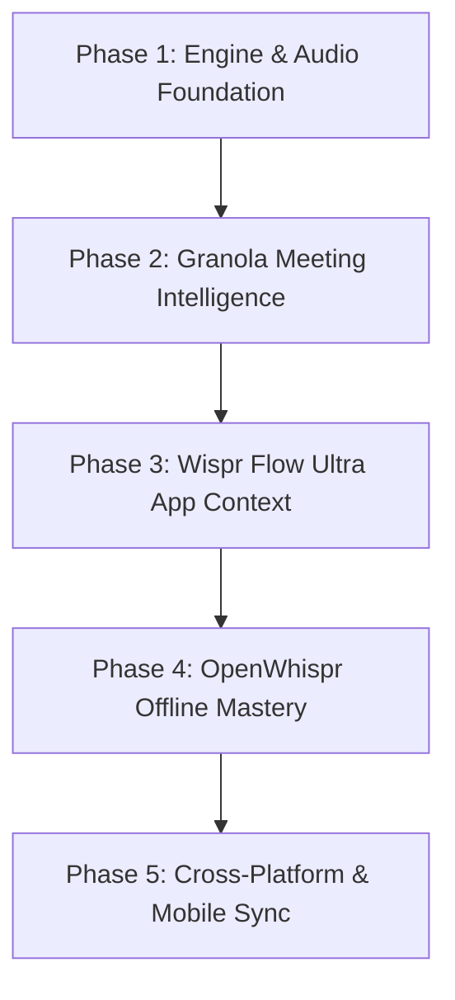

# Moustache Product Roadmap

This document outlines the strategic roadmap and future vision for **Moustache**, synthesizing the finest capabilities of **Granola**, **Wispr Flow**, and **OpenWhispr** into a unified, privacy-first desktop voice intelligence platform.

---

## 🎯 Vision

Moustache is the ultimate open desktop companion for speech-to-text, real-time meeting intelligence, and context-aware dictation. Completely private by default, Moustache blends lightning-fast local speech recognition with app-aware contextual transformations to make talking faster, more natural, and more expressive than typing.

---

## 🗺️ Milestone Overview

---

## Phase 1: Core Engine & Audio Pipeline

_Goal: Sub-200ms latency, zero dropped syllables, and studio-grade audio capture._

- [x] **Global Key Management Suite**
  - [x] Push-to-talk hold sliders (100ms–1000ms threshold)
  - [x] Double-tap detection window calibration (150ms–600ms)
  - [x] Automatic stuck-key recovery failsafe
  - [x] Real-time shortcut conflict detector and profile switcher (Vim, Coder, One-Handed)
- [ ] **Whisper Large-v3-Turbo & Distil-Whisper Integration**
  - [ ] Bundle pre-quantized `large-v3-turbo` GGUF models for 8x speedup on Apple Silicon and modern x64 GPUs.
  - [ ] Add streaming interim transcript display directly into the Flow Bar capsule.
- [ ] **Adaptive Noise Gate & Dual-Channel Cancellation**
  - [ ] Voice Activity Detection (VAD) with Silero v5 for accurate sentence boundary detection.
  - [ ] Automatic background hum filtering (fans, AC, keyboard clicks).
- [x] **Multi-Channel Speaker Diarization**
  - [x] Speaker diarization & timeline assignment with real-time speaker pill selector and multi-speaker rename sync across transcripts.
  - [ ] Local PyAnnote / Sortformer integration for identifying who is speaking in multi-person rooms without external cloud services.

---

## Phase 2: Meeting Intelligence 2.0 (Granola Supercharged)

_Goal: Turn messy verbal syncs into structured executive decisions, action items, and knowledge bases._

- [x] **Meeting Scratchpad & Template Engine**
  - [x] Real-time hybrid notes: AI blends your live typed scratchpad bullet points with verbatim spoken audio.
  - [x] Pre-built templates for 1-on-1s, Standups, Sales / Client syncs, and Brainstorms.
  - [x] Interactive checkable action item extraction with auto-assigned stakeholders.
  - [x] One-click Markdown (`.md`) export.
- [x] **Bot-less System Audio Loopback Recording**
  - [x] Dual loopback & microphone audio capture with active VU meter visualization—record high-fidelity system audio from Zoom, Google Meet, or Microsoft Teams calls without external bots.
- [x] **Calendar & Meeting Auto-Join Integration**
  - [x] Connect calendar events (Google Meet, Zoom, Microsoft Teams) with countdown timers and attendee previews.
  - [x] Proactive meeting join bar with 1-click meeting start and auto-join toggle.
- [x] **Automated Post-Meeting Workflows**
  - [x] Instant follow-up email generator tailored to meeting participants with 1-click `mailto:` launch.
  - [x] Direct export connectors: Slack mrkdwn blocks, Linear / Jira ticket generator, and Notion database markdown exporter.

---

## Phase 3: Wispr Flow Ultra (Deep App Awareness & Voice Macros)

_Goal: The app automatically behaves like an expert for whatever software you are using._

- [x] **Contextual Tone & Formatting Rules**
  - [x] Chat mode: concise sentences and auto-press Enter for Slack, Discord, and Telegram.
  - [x] Code mode: preserve syntax, case conversions (`camelCase`, `snake_case`, `UPPER_SNAKE`), and symbol formatting for VS Code and Cursor.
  - [x] Email mode: formal salutations and polite phrasing for Gmail and Outlook.
  - [x] Vocabulary boost tags per application.
  - [x] Interactive test workbench rule simulator.
- [x] **Screen & Field Vision Context (Voice Form Auto-Fill)**
  - [x] Voice Dispatch Assistant: parse complex natural speech into structured form fields (Title, Email, Priority, Notes) with 1-click apply.
  - [ ] Multi-turn conversational voice editing: _"Fix the second bullet point and make it sound punchier."_
- [x] **Voice Snippet Variables & Dynamic Expansion**
  - [x] Dynamic variable chips `{{date}}`, `{{time}}`, `{{clipboard}}`, and `{{speaker}}` with automatic live preview resolution.
- [ ] **Cross-Application Voice Macros**
  - [ ] Chain spoken actions: _"Send this to Sarah on Slack and archive the email."_

---

## Phase 4: OpenWhispr Offline Power & Enterprise Security

_Goal: Uncompromising privacy, air-gapped readiness, and sovereign AI control._

- [x] **Offline Audio File Transcriber**
  - [x] Support drag-and-drop batch import of `.mp3`, `.wav`, `.m4a`, and `.aac` audio recordings.
- [x] **In-App Upgrade Manager**
  - [x] Channel selector (Stable, Beta, Nightly) with live progress bar and release catalog.
- [x] **Local LLM Fine-Tuning & Prompt Stacking**
  - [x] Sequential multi-prompt pipeline stack selector (e.g. Tone Polish, Grammar Fix, Executive Summary, Code Format) for chaining custom transforms.
  - [ ] Run fully local GGUF models via llama.cpp or Ollama without sending any data over the internet.
- [x] **Team & Organization Vault Sync**
  - [x] Encrypted JSON vault export/import bundles for sharing prompt stacks, dictionaries, snippets, and app rules across engineering teams.
  - [ ] Zero-knowledge client-side encryption for cloud backup options.

---

## Phase 5: Multi-Modal Expansion & Linux First-Class Support

_Goal: Moustache everywhere—desktop, terminal, and mobile._

- [x] **Linux Backend Foundation**
  - [x] Stubs and core traits implemented for Linux platform builds.
- [ ] **Native Linux UI & Wayland / X11 Global Hotkeys**
  - [ ] Global shortcut listener using `libinput` / X11 / Wayland desktop portals.
  - [ ] PipeWire / ALSA audio source integration for Linux desktop users.
- [ ] **Local Network Mobile Companion App (iOS / Android)**
  - [ ] Turn your phone into a high-fidelity wireless microphone for your computer over local Wi-Fi or Bluetooth.
  - [ ] Peer-to-peer sync without intermediate cloud servers.
- [ ] **Moustache CLI (`moustache-cli`)**
  - [ ] Pipe audio files directly into terminal standard output: `moustache transcribe meeting.mp3 --template standup > notes.md`.

---

## 💡 Submitting Feature Requests

Have an idea or want to vote on roadmap items? Open a proposal on [GitHub Discussions](https://github.com/chillyhtpt/moustache/discussions) or submit a feature request on [GitHub Issues](https://github.com/chillyhtpt/moustache/issues).
